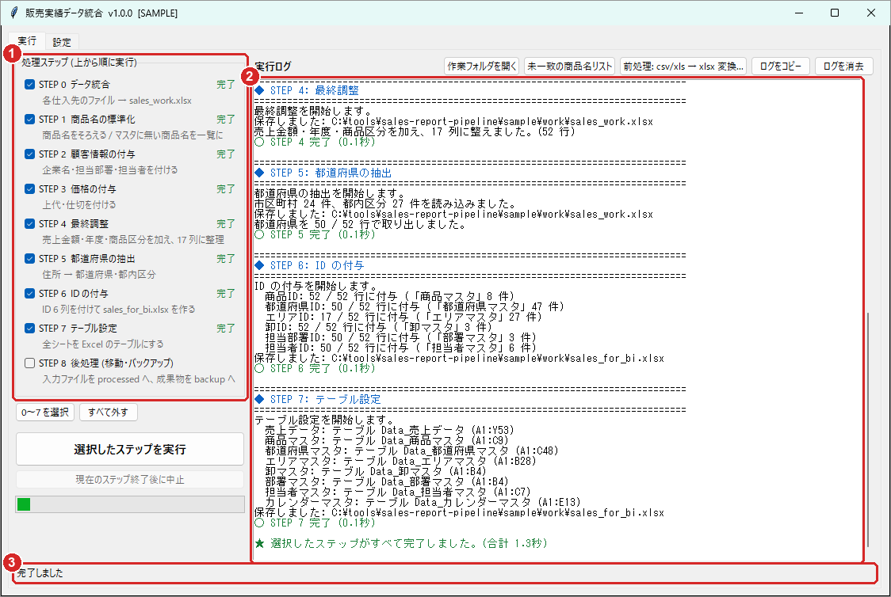
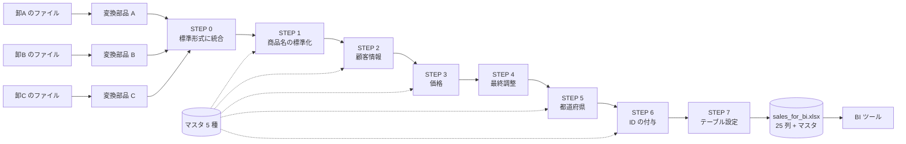

# 販売実績データ統合パイプライン / Sales Report Pipeline

<a id="japanese"></a>

**日本語** | [English](#english)

複数の卸（仕入先）から毎月届く、**形式がばらばらの販売実績ファイル**を、
BI ツール（Power BI など）でそのまま分析できる **1 つの標準データ**に仕上げるための、小さな Python ツールです。

画面（GUI）から、チェックを入れてボタンを押すだけで動きます。



> **このリポジトリの位置づけ**
> 販売実績の統合という課題に対する、**技術の骨子**です（考え方と、それを手元で確かめられる最小限の実装）。
> 同梱のデータ（仕入先・得意先・商品・価格・担当者）は**すべて架空**で、特定の組織の情報は含みません。
> 同じ課題を持つ組織が、自分たちの仕入先とマスタに差し替えて使うための土台として公開しています。

---

## 何を解決するのか

| 困りごと | このツールでの解決 |
| --- | --- |
| 卸ごとに帳票の形が違う（見出しの名前、表題の行、合計行、横持ちの集計表 …） | 卸ごとの違いを **小さな変換部品（1 社 = 1 ファイル）** に閉じ込め、全社を同じ「標準形式」に合流させる |
| 同じ商品・同じ得意先なのに、卸によって書き方が違う | マスタと照合して **標準の名前にそろえる**（全角/半角・余分な空白の違いは自動で吸収） |
| BI で使うには、価格・担当・地域・ID などが足りない | マスタから **価格・担当部署・担当者・都道府県・各種 ID** を付け、売上金額を計算する |
| 手作業は、間違えても気づけない | **気づける仕組み**を入れる: 実行順の誤りを止める／あやしい点は「要確認」として必ず表示する／保存の途中で失敗してもファイルを壊さない |

入力から出力までの流れ:



## 5 分で試す（サンプルデータ）

必要なもの: Windows、Python 3.10 以降、Excel（結果を開いて見るため）。

1. このリポジトリをダウンロードして、好きな場所に置く。
2. `setup.bat` をダブルクリック（必要なライブラリ pandas / openpyxl などが入ります。最初の 1 回だけ）。
3. `run_sample.bat` をダブルクリック。タイトルに `[SAMPLE]` と出た画面が開きます。
4. **「選択したステップを実行」** を押す。数秒で STEP 0〜7 がすべて「完了」になります。
5. **「作業フォルダを開く」** を押し、`sales_for_bi.xlsx` を開く。これが BI に取り込む完成ファイルです。

サンプルは 3 社分・52 明細。3 社はわざと形を変えてあります（素直な明細表／表題と合計行のある帳票／店舗 × 商品の横持ち表）。
`reset_sample.bat` で、いつでも最初の状態に戻せます。

「要確認」の表示を見てみたいときは、コマンド プロンプトで次を実行してから `run_sample.bat` を起動してください
（マスタに無い商品、数値でない数量、都道府県の分からない住所を 1 件ずつ混ぜたサンプルになります）。

```
python tools\make_sample_data.py --with-issues
```

## 自分のデータで使う

1. 仕入先ごとの変換部品を作る（`suppliers/_template.py` をコピーして書く）。
2. マスタ 5 種を、サンプル（`sample/masters/`）と同じ形で用意する。
3. `run_gui.bat` で起動し、「設定」タブでフォルダとマスタの場所を指定する。

くわしくは [流用ガイド](docs/adaptation-guide.md) を見てください。

## ドキュメント

| 文書 | 内容 |
| --- | --- |
| [設計思想](docs/design.md) | 技術の核、設計上の原則とその理由、データの流れ、あえてやらないこと |
| [使用説明書](docs/user-guide.md) | 画面の見方、毎月の作業の手順、「要確認」「エラー」への対応、出力ファイルの仕様 |
| [流用ガイド](docs/adaptation-guide.md) | 他の組織で使うための手引き: 変換部品の書き方、マスタの用意、列や業務ルールの変え方、機密情報を混ぜないための注意 |

## フォルダ構成

```
sales-report-pipeline/
├─ run_gui.bat / run_gui.py     画面を起動する（自分の設定で）
├─ run_sample.bat               画面を起動する（サンプルデータで）
├─ reset_sample.bat             サンプルを最初の状態に戻す
├─ setup.bat / requirements.txt 必要なライブラリを入れる
├─ LICENSE                      ライセンス（MIT）
├─ pipeline_app/                本体
│   ├─ config.py                  設定の読み書き、変換部品の検出
│   ├─ state.py                   列の定義、処理の進み具合の判定と記録
│   ├─ steps.py                   各ステップの処理
│   ├─ runner.py                  ステップの定義と実行の制御
│   ├─ gui.py                     画面
│   └─ plugin.py                  変換部品から使う道具
├─ suppliers/                   仕入先ごとの変換部品（process_*.py）とひな形
├─ sample/                      サンプル一式（入力・マスタ・期待値・設定）
├─ tools/make_sample_data.py    サンプルを作るスクリプト
├─ tests/                       自動テスト
└─ docs/                        ドキュメント
```

## テスト

```
python -m unittest discover -s tests -v
```

サンプルを一時フォルダに作って全ステップを実行し、出力を期待値とセル単位（値と型）で比べます。
期待値は、処理プログラムを使わずに `tools/make_sample_data.py` の中の「元になる事実の表」から組み立てています。
あわせて、実行順の誤り・二重実行・保存の失敗・壊れた入力ファイルなどで、誤った出力ができないことを確かめます。

## 動作環境

- Windows（Windows 11 で動作を確認。起動用のバッチファイルと画面は Windows を前提にしています）
- Python 3.10 以降、pandas 2.x / 3.x、openpyxl 3.1 以降（`.xls` を変換する場合のみ xlrd）
- 規模のめやす: 3 万行で全ステップ 2〜3 分（開発に使った PC での実測）

## おことわり

- これは骨子となる実装です。業務でお使いになる前に、ご自身のデータで結果を必ず検証してください。
- 同梱の「都道府県テーブル」は主な市だけを載せた見本です。実運用では全国の市区町村を用意してください。

## ライセンス

[MIT License](LICENSE) です。利用・改変・再配布・商用利用は自由です。
著作権表示とライセンス文を残してください。無保証です。

---

<a id="english"></a>

# Sales Report Pipeline

[日本語](#japanese) | **English**

A small Python tool that turns the **monthly sales reports you receive from several wholesalers — each in a different layout —**
into **one standard dataset** that a BI tool (Power BI and the like) can analyse as it is.

It runs from a GUI: tick the steps and press one button.

> **What this repository is**
> It is a **technical skeleton** for the problem of consolidating sales reports: the ideas, plus a minimal implementation you can try on your own PC.
> All bundled data (wholesalers, customers, products, prices, staff) is **fictional**, and nothing here belongs to any particular organisation.
> It is published as a starting point for organisations with the same problem, to be filled in with their own wholesalers and master data.

> **Language note**
> The documentation is bilingual. The GUI, the log messages, the sample data and the column names of the output are in Japanese.
> The [user guide](docs/user-guide.md#english) has a glossary of the on-screen labels and the columns.

## What it solves

| Problem | How this tool handles it |
| --- | --- |
| Every wholesaler uses a different form (header names, title rows, total rows, cross-tab summaries …) | The differences are confined to **small converters (one file per wholesaler)** that bring every report into the same "standard form" |
| The same product or the same customer is written differently by each wholesaler | Names are matched against master data and **replaced by the standard name** (full-width/half-width and stray spaces are absorbed automatically) |
| The reports lack what analysis needs: prices, the person in charge, region, IDs | **Prices, department, person in charge, prefecture and IDs** are added from master data, and the sales amount is calculated |
| Manual work fails silently | **Mechanisms that make mistakes visible**: steps cannot be run in a wrong order, anything doubtful is always shown as "needs review", and a failed save never corrupts a file |

The flow from input to output is shown in the diagram in the Japanese section above (STEP 0 merges the converted reports; STEP 1–7 standardise product names, add customer information and prices, tidy the columns, extract the prefecture, add IDs and create Excel tables; the result is `sales_for_bi.xlsx` with 25 columns plus the master sheets).

## Try it in five minutes (sample data)

Requirements: Windows, Python 3.10 or later, and Excel (to open the result).

1. Download this repository and put it anywhere.
2. Double-click `setup.bat` (installs pandas, openpyxl and so on; needed once).
3. Double-click `run_sample.bat`. A window with `[SAMPLE]` in its title opens.
4. Press the large button **「選択したステップを実行」** (Run the selected steps). Within a few seconds STEP 0–7 all show 「完了」 (Done).
5. Press **「作業フォルダを開く」** (Open the work folder) and open `sales_for_bi.xlsx`. That is the finished file for the BI tool.

The sample has three wholesalers and 52 detail rows. The three reports deliberately differ in shape: a plain detail table, a form with title rows and a total row, and a store × product cross-tab.
`reset_sample.bat` puts the sample back to its initial state at any time.

To see what "needs review" looks like, run the following and then start `run_sample.bat`
(it mixes in one product missing from the master, one non-numeric quantity and one address whose prefecture cannot be determined):

```
python tools\make_sample_data.py --with-issues
```

## Use it with your own data

1. Write a converter for each wholesaler (copy `suppliers/_template.py`).
2. Prepare the five master files in the same form as the samples in `sample/masters/`.
3. Start with `run_gui.bat` and set the folders and master files on the 「設定」 (Settings) tab.

See the [adaptation guide](docs/adaptation-guide.md#english) for details.

## Documentation

| Document | Contents |
| --- | --- |
| [Design](docs/design.md#english) | The core ideas, the design principles and the reasons behind them, the data flow, what is deliberately left out |
| [User guide](docs/user-guide.md#english) | The screen, the monthly procedure, what to do on "needs review" and "error", the output specification |
| [Adaptation guide](docs/adaptation-guide.md#english) | How another organisation can use it: writing converters, preparing master data, changing columns and business rules, keeping confidential data out |

## Folder layout

```
sales-report-pipeline/
├─ run_gui.bat / run_gui.py     start the GUI (your own settings)
├─ run_sample.bat               start the GUI (sample data)
├─ reset_sample.bat             rebuild the sample
├─ setup.bat / requirements.txt install the required libraries
├─ LICENSE                      licence (MIT)
├─ pipeline_app/                the application
│   ├─ config.py                  settings, discovery of converters
│   ├─ state.py                   column definitions, stage detection and record
│   ├─ steps.py                   the processing steps
│   ├─ runner.py                  step list and execution control
│   ├─ gui.py                     the GUI
│   └─ plugin.py                  helpers for converters
├─ suppliers/                   one converter per wholesaler (process_*.py) and a template
├─ sample/                      sample inputs, master data, expected output, settings
├─ tools/make_sample_data.py    builds the sample
├─ tests/                       automated tests
└─ docs/                        documentation
```

## Tests

```
python -m unittest discover -s tests -v
```

The tests build the sample in a temporary folder, run every step and compare the output with the expected values cell by cell (value and type).
The expected values are assembled inside `tools/make_sample_data.py` from the underlying facts, without calling the processing code.
The tests also check that a wrong step order, a repeated run, a failed save or a broken input file cannot produce a wrong output.

## Environment

- Windows (checked on Windows 11; the batch files and the GUI assume Windows)
- Python 3.10 or later, pandas 2.x / 3.x, openpyxl 3.1 or later (xlrd only when converting `.xls`)
- Scale: about 2–3 minutes for all steps on 30,000 rows (measured on the development PC)

## Notes

- This is a skeleton implementation. Verify the results with your own data before using it for real work.
- The bundled prefecture table lists only major cities as an example. Prepare a nationwide list for real use.

## Licence

[MIT License](LICENSE). You may use, modify, redistribute and use it commercially.
Keep the copyright notice and the licence text. There is no warranty.
