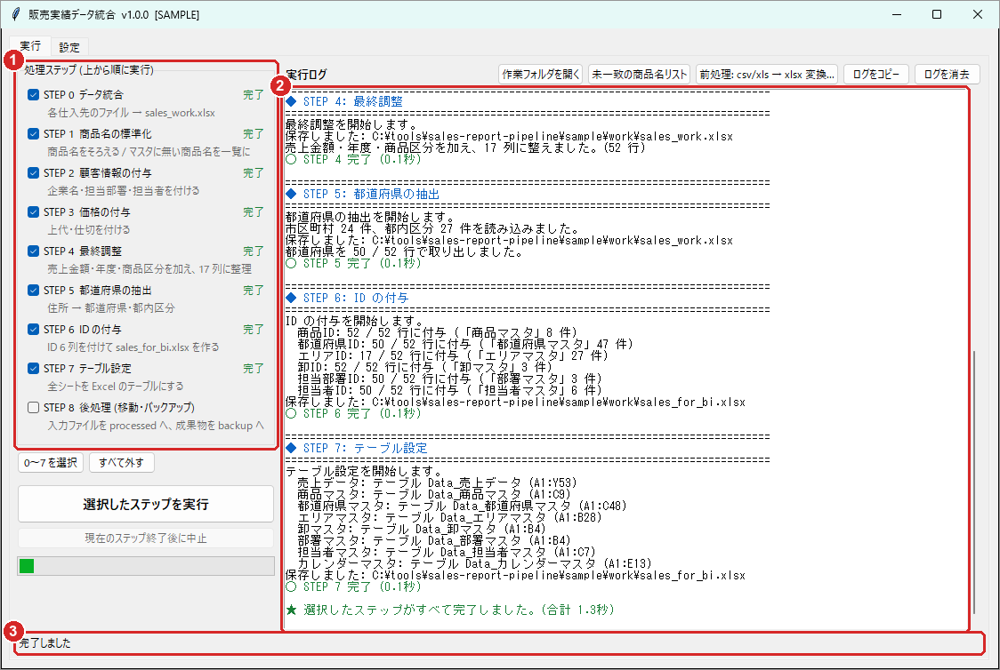
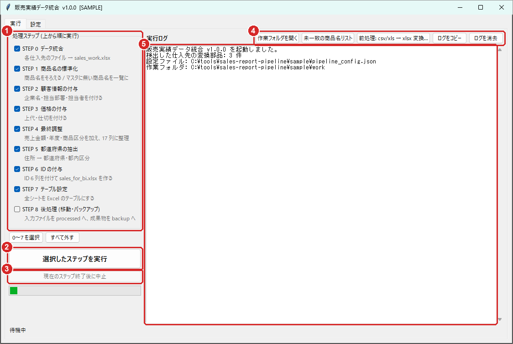
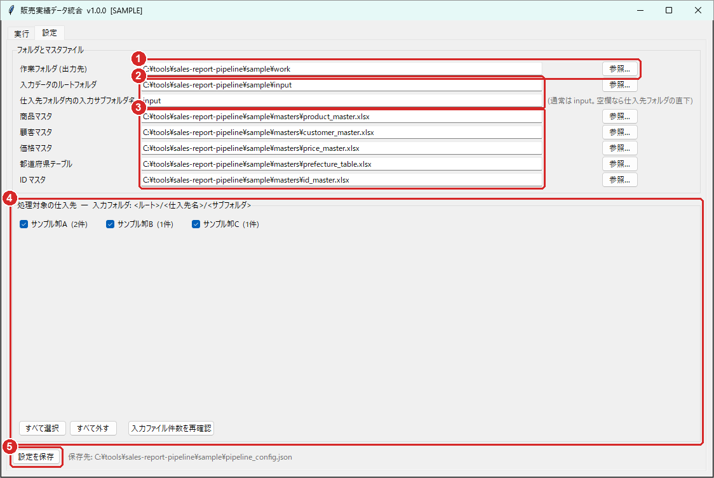
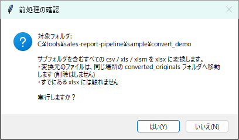
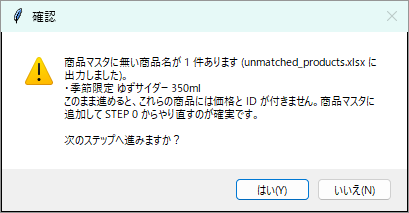
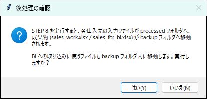
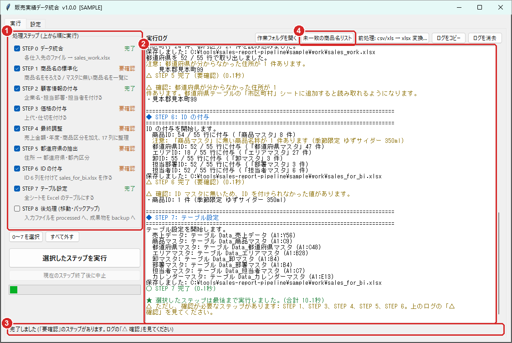
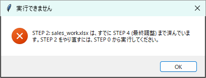
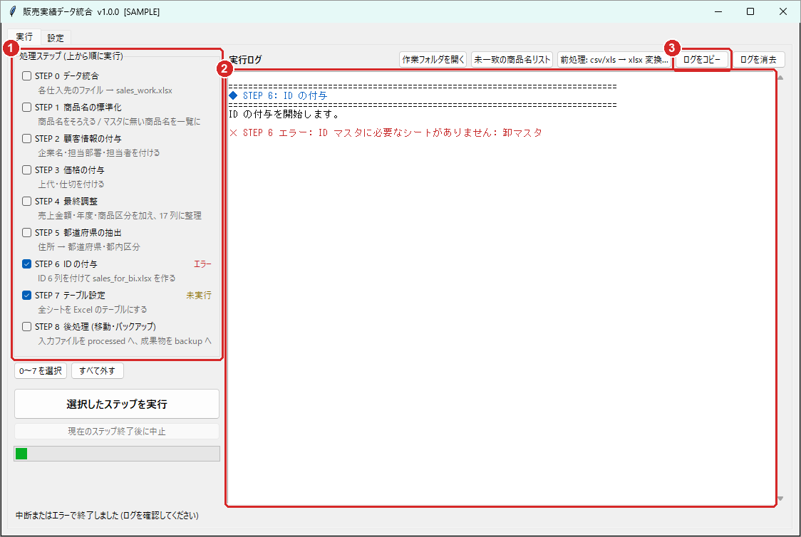

# 使用説明書 / User Guide

<a id="japanese"></a>

**日本語** | [English](#english)

毎月の作業を、画面の操作に沿って説明します。
はじめての方は、まず同梱のサンプルで「2. サンプルで動かしてみる」までを試してください。

- [1. 準備（最初の 1 回だけ）](#1-準備最初の-1-回だけ)
- [2. サンプルで動かしてみる](#2-サンプルで動かしてみる)
- [3. 画面の見方](#3-画面の見方)
- [4. 毎月の作業](#4-毎月の作業)
- [5. 「要確認」が出たら](#5-要確認が出たら)
- [6. 「エラー」「実行できません」が出たら](#6-エラー実行できませんが出たら)
- [7. やり直しのルール](#7-やり直しのルール)
- [8. 出力ファイルの仕様](#8-出力ファイルの仕様)
- [9. 作業フォルダにできるファイル](#9-作業フォルダにできるファイル)
- [10. 困ったときは](#10-困ったときは)

---

## 1. 準備（最初の 1 回だけ）

1. **Python を入れる。** Python 3.10 以降が必要です。インストール時に「Add python.exe to PATH」にチェックを入れてください。
2. **ライブラリを入れる。** フォルダの中の `setup.bat` をダブルクリックします。黒い画面に `Setup finished.` と出れば完了です。

起動用のファイルは 2 つあります。

| ファイル | 使う設定 | いつ使うか |
| --- | --- | --- |
| `run_sample.bat` | 同梱のサンプル（`sample/pipeline_config.json`） | 動きを確かめるとき、練習するとき |
| `run_gui.bat` | 自分の設定（`pipeline_config.json`） | 本番の作業 |

サンプルで起動したときは、画面のタイトルに `[SAMPLE]` と表示されます。本番と取り違えないための目印です。

## 2. サンプルで動かしてみる

1. `run_sample.bat` をダブルクリックします。
2. 左側の STEP 0〜7 にチェックが入っていることを確かめ、**「選択したステップを実行」** を押します。
3. 数秒で、すべてのステップの右側に緑色の **「完了」** が出ます。



4. **「作業フォルダを開く」** を押します。`sales_for_bi.xlsx` が完成ファイルです。開くと、52 行・25 列の「売上データ」シートと、マスタのシートが入っています。

サンプルを最初の状態に戻すには、`reset_sample.bat` をダブルクリックします。

## 3. 画面の見方

### 3.1 「実行」タブ



| 番号 | 名前 | 説明 |
| --- | --- | --- |
| ① | 処理ステップ | チェックを入れたステップが、上から順に実行されます。右側に結果（完了／要確認／エラー／未実行）が出ます |
| ② | 実行ボタン | チェックを入れたステップを実行します |
| ③ | 中止ボタン | 実行中だけ押せます。**いま動いているステップが終わってから**止まります（途中で打ち切ってファイルを壊すことはありません） |
| ④ | 道具のボタン | 作業フォルダを開く／未一致の商品名リストを開く／前処理（csv・xls の変換）／ログをコピー／ログを消去 |
| ⑤ | 実行ログ | 処理の経過です。赤はエラー、茶色は注意、緑は完了です。同じ内容が作業フォルダの `logs` にも保存されます |

各ステップの内容:

| ステップ | すること | 使うマスタ |
| --- | --- | --- |
| STEP 0 データ統合 | 各仕入先のファイルを標準形式に直して 1 つにまとめる | — |
| STEP 1 商品名の標準化 | 商品名を標準の名前にそろえる。マスタに無い商品名を一覧にする | 商品マスタ |
| STEP 2 顧客情報の付与 | 企業名・担当部署・担当者を付ける | 顧客マスタ |
| STEP 3 価格の付与 | 上代・仕切を付ける | 価格マスタ |
| STEP 4 最終調整 | 売上金額・年度・商品区分を計算し、17 列に整える | — |
| STEP 5 都道府県の抽出 | 住所から都道府県・都内区分を取り出す | 都道府県テーブル |
| STEP 6 ID の付与 | ID 6 列を付けて、完成ファイル `sales_for_bi.xlsx` を作る | ID マスタ |
| STEP 7 テーブル設定 | 全シートを Excel のテーブルにする（BI から名前で参照できる） | — |
| STEP 8 後処理 | 入力ファイルを `processed` へ、成果物を `backup` へ移す | — |

STEP 8 だけは、最初はチェックが外れています。出力を確かめ終わってから実行するステップだからです。

### 3.2 「設定」タブ



| 番号 | 項目 | 説明 |
| --- | --- | --- |
| ① | 作業フォルダ（出力先） | 作業ファイル・完成ファイル・ログができる場所 |
| ② | 入力データのルートフォルダ／サブフォルダ名 | 仕入先のファイルは `<ルート>/<仕入先名>/<サブフォルダ名>/` に置きます。サブフォルダ名はふつう `input` です |
| ③ | マスタファイル | 商品マスタ・顧客マスタ・価格マスタ・都道府県テーブル・ID マスタの場所 |
| ④ | 処理対象の仕入先 | チェックを外した仕入先は処理しません。名前の右に、入力フォルダにあるファイルの数が出ます（「フォルダなし」は入力フォルダが見つからないという意味です） |
| ⑤ | 設定を保存 | 設定は、実行ボタンを押したときと、画面を閉じたときにも自動で保存されます |

## 4. 毎月の作業

### 手順 1: 仕入先のファイルを置く

各仕入先から届いたファイルを、それぞれの入力フォルダに置きます。

```
<入力データのルート>/
  ├─ サンプル卸A/
  │    ├─ input/        ← ここに今月のファイルを置く
  │    └─ processed/    ← 処理が済んだファイルが移される（自動で作られる）
  ├─ サンプル卸B/
  │    └─ input/
  └─ ...
```

**ファイル名の先頭を、年月 6 桁と `_` にしてください。** 例: `202610_サンプル卸A.xlsx`
この 6 桁が「計上月」になります。年月が無いファイルは取り込まれますが、計上月が空になり「要確認」と表示されます。

同じ仕入先のファイルを複数置いてもかまいません（2 か月分をまとめて処理する、など）。

### 手順 2: xlsx でないファイルを変換する（必要なときだけ）

取り込めるのは `.xlsx` だけです。`.csv`、`.xls`、`.xlsm` で届いた場合は、**「前処理: csv/xls → xlsx 変換…」** を押し、入力データのルートフォルダを選びます。



- サブフォルダの中まで、まとめて変換します。
- 変換元のファイルは削除せず、同じ場所の `converted_originals` フォルダへ移します。
- すでにある `.xlsx` には触れません。同じ名前の `.xlsx` がある場合は、変換せずに知らせます。

### 手順 3: 件数を確かめる

「設定」タブを開き、**「入力ファイル件数を再確認」** を押します。
仕入先ごとの件数が、置いたファイルの数と合っているかを確かめてください。

### 手順 4: STEP 0〜7 を実行する

「実行」タブで STEP 0〜7 にチェックが入っていることを確かめ（「0〜7 を選択」を押すと確実です）、
**「選択したステップを実行」** を押します。

- すべて「完了」になれば、手順 6 へ進みます。
- 途中で確認の画面が出たら、手順 5 を見てください。

### 手順 5: 確認の画面に答える

確かめるべき点があると、次のような画面が出ます。



- **「はい」** … そのまま次のステップへ進みます。
- **「いいえ」** … そこで止まります。マスタを直すなどしてから、やり直します。

どちらを選べばよいかは [5. 「要確認」が出たら](#5-要確認が出たら) にまとめてあります。迷ったら「いいえ」で止め、内容を確かめてください。

### 手順 6: 出力を確かめる

**「作業フォルダを開く」** を押し、`sales_for_bi.xlsx` を開きます。最低限、次を確かめてください。

- 行数が、想定とかけ離れていないか（実行ログの STEP 0 に、仕入先ごとの取り込み行数が出ています）
- 「計上月」が今月になっているか
- 「売上金額」が空の行が、想定より多くないか（価格が付かなかった行です）

### 手順 7: BI に取り込む

`sales_for_bi.xlsx` を BI ツールに取り込みます。各シートはテーブルになっており、`Data_売上データ`、`Data_商品マスタ` などの名前で参照できます。

### 手順 8: 後処理（STEP 8）を実行する

取り込みが済んだら、**「すべて外す」** を押してから STEP 8 だけにチェックを入れ、実行します。確認の画面が出ます。



「はい」を押すと、

- 今回取り込んだ入力ファイルが、各仕入先の `processed` フォルダへ移ります。
- `sales_work.xlsx`、`sales_for_bi.xlsx` などの成果物が、作業フォルダの `backup/<日時>/` へ移ります。

入力フォルダが空になり、来月のファイルを置ける状態になります。
統合のあとに届いたファイルや、読み込めなかったファイルは**移さずに残し**、そのことを知らせます。

## 5. 「要確認」が出たら

「要確認」は、**処理は最後まで行ったが、人が確かめるべき点がある**という意味です。
実行ログの「△ 確認」に内容が出ます。



| ステップ | 表示される内容 | どうするか |
| --- | --- | --- |
| STEP 0 | 取り込めなかったファイルがある | 実行ログに理由が出ています。見出しが変わっていないか、ファイルが壊れていないかを確かめます。仕入先が様式を変えた場合は、変換部品の修正が必要です |
| STEP 0 | 入力ファイルが無かった仕入先がある | 今月その仕入先の報告が無いなら問題ありません。あるはずなら、置き場所とファイルの種類（xlsx か）を確かめます |
| STEP 0 | ファイル名の先頭が年月 6 桁になっていない | ファイル名を `202610_…` の形に直して、STEP 0 からやり直します |
| STEP 1 | 商品マスタに無い商品名がある | 「未一致の商品名リスト」ボタンで一覧を開きます。**新しい書き方**なら商品マスタの「変換表」に、**新しい商品**なら「標準商品」・価格マスタ・ID マスタに追加して、STEP 0 からやり直します |
| STEP 2 | 顧客マスタで同じ得意先の内容が食い違っている | 顧客マスタの重複を整理します（上にある行が使われています） |
| STEP 3 | 価格マスタに数値でない価格がある | 価格マスタを直します。その商品の価格と売上金額は空になっています |
| STEP 3 | 仕切が付かなかった商品がある | 価格マスタにその商品を追加します |
| STEP 4 | 数値として読めない値があった | 元のファイルの数量・容量の欄を確かめます。その値は空になっています |
| STEP 5 | 都道府県が分からない住所がある | 都道府県テーブルの「市区町村」シートに、その市区町村を追加します |
| STEP 6 | ID を付けられなかった値がある | ID マスタの該当するシートに追加します |
| STEP 6 | ID マスタで、同じ値に別々の ID が登録されている | ID マスタの重複を整理します（上にある行が使われています） |
| STEP 7 | データ行が無いため、テーブルにしなかったシートがある | ID マスタのそのシートが見出しだけになっています。中身を入れて STEP 6 から実行します |
| STEP 8 | 同名のファイルがあったので別名で保存した | 同じ月を 2 回処理していないか確かめます |
| STEP 8 | 入力フォルダに残したファイルがある | 統合に含まれていないファイルです。次回に処理するか、不要なら手で片付けます |
| STEP 8 | STEP 0 の記録が無いため、入力ファイルを移動していない | どのファイルを取り込んだのか分からない状態です（STEP 8 を 2 回実行した、記録ファイルを消した、など）。入力フォルダを確かめ、処理が済んだファイルは手で `processed` へ移します |

**マスタを直したあとは、STEP 0 からやり直すのが確実です。**
何件かの商品に価格が付かなくても今月は進めたい、という場合は「はい」で進めてかまいません。その行は、価格と売上金額が空のまま出力されます。

## 6. 「エラー」「実行できません」が出たら

### 「実行できません」

実行ボタンを押した直後に出ます。**まだ何も実行されていません。**



| 表示される内容 | 意味と対応 |
| --- | --- |
| 「〜」が見つかりません | フォルダやマスタの場所が正しくありません。「設定」タブを確かめます |
| 作業フォルダに sales_work.xlsx がありません | STEP 0 がまだです。STEP 0 から実行します |
| すでに STEP 4 (最終調整) まで済んでいます | 済んだファイルに同じ処理を重ねることはできません。やり直すなら STEP 0 から実行します |
| STEP 1 (商品名の標準化) がまだ実行されていません | STEP 1 を飛ばしています。STEP 1 も選んで実行します |
| STEP 4 の前に STEP 2 … を実行してください | 顧客情報か価格がまだ付いていません |
| 処理対象の仕入先が 1 つも選択されていません | 「設定」タブで仕入先にチェックを入れます |

### 「エラー」

実行の途中で、続けられなくなったときに出ます。そのステップで止まり、後ろのステップは「未実行」になります。
作業ファイルと完成ファイルは、**そのステップを実行する前のまま**残ります。



| 表示される内容 | 対応 |
| --- | --- |
| ファイルを保存できません。Excel で開いていないか確認してください | 出力ファイルやマスタを Excel で開いたままにしていないか確かめ、閉じてからもう一度実行します |
| 〜 に「〜」シートがありません ／ 必要な列がありません | マスタのシート名か見出しが変わっています。サンプルのマスタと見比べて直します |
| 統合できるデータがありませんでした | 入力フォルダに xlsx が 1 つもありません。置き場所とサブフォルダ名を確かめます |
| 必要なライブラリ「〜」が入っていません | `setup.bat` を実行します |
| 予期しないエラーが発生しました | **「ログをコピー」** を押し、内容をそのまま管理者に送ってください |

エラーの原因を取り除いたら、**エラーになったステップから後ろ**を選んで実行すれば続きから再開できます。

## 7. やり直しのルール

| やりたいこと | 方法 |
| --- | --- |
| 入力ファイルを差し替えた、追加した | STEP 0 からやり直す |
| 商品マスタを直した | STEP 0 からやり直す（STEP 4 の前なら、STEP 1 と STEP 3 をやり直すのでもよい。STEP 1 をやり直すと、付いていた価格は外れます） |
| 顧客マスタ・価格マスタを直した（STEP 4 の前） | STEP 2 または STEP 3 から実行する |
| 顧客マスタ・価格マスタを直した（STEP 4 より後） | STEP 0 からやり直す |
| 都道府県テーブルを直した | STEP 5 から実行する |
| ID マスタを直した | STEP 6 から実行する |
| 迷ったとき | **STEP 0〜7 を全部**実行する（いちばん確実で、数万行でも数分です） |

STEP 0 は、入力フォルダにあるファイルから作業ファイルを作り直します。何度実行しても同じ結果になります。
ただし、**STEP 8 を実行したあと**は入力ファイルが `processed` に移っています。やり直すときは、ファイルを `input` に戻してください。

## 8. 出力ファイルの仕様

`sales_for_bi.xlsx` の「売上データ」シート（テーブル名 `Data_売上データ`）。1 行が「1 つの卸・1 つの月・1 つの得意先・1 つの商品」です。

| 列 | 名前 | 内容 | 元になるもの |
| --- | --- | --- | --- |
| A | 卸名 | 仕入先の名前 | 変換部品の `SUPPLIER_NAME` |
| B | 計上月 | 年月（例: 202610） | ファイル名の先頭 6 桁 |
| C | 担当部署 | 自社の担当部署 | 顧客マスタ |
| D | 担当者 | 自社の担当者 | 顧客マスタ |
| E | 得意先名称 | 店・納品先の名前（顧客マスタにあれば、マスタの表記） | 仕入先のファイル |
| F | 企業名 | 得意先の属する企業。分からなければ「(空白)」 | 顧客マスタ |
| G | 商品名称 | 標準の商品名 | 仕入先のファイル + 商品マスタ |
| H | 容量 | ml 単位の数値（「1.8L」→ 1800） | 仕入先のファイル |
| I | 入数 | 1 ケースの本数 | 仕入先のファイル |
| J | 上代 | 希望小売価格 | 価格マスタ |
| K | 販売本数 | 売れた本数 | 仕入先のファイル |
| L | 仕切 | 卸への販売単価 | 価格マスタ |
| M | 売上金額 | 販売本数 × 仕切 | 計算 |
| N | 年度 | 計上月の年 | 計算 |
| O | 商品区分 | 「通常商品」または「終売商品」（商品名に「終売」を含むもの） | 計算 |
| P | 住所 | 得意先の住所 | 仕入先のファイル |
| Q | 都道府県 | 住所から取り出した都道府県 | 住所 + 都道府県テーブル |
| R | 都内区分 | 東京都の場合の区・市の名前 | 住所 + 都道府県テーブル |
| S | 商品ID | | ID マスタ「商品マスタ」 |
| T | 都道府県ID | | ID マスタ「都道府県マスタ」 |
| U | エリアID | 都内区分に対応する ID | ID マスタ「エリアマスタ」 |
| V | 卸ID | | ID マスタ「卸マスタ」 |
| W | 担当部署ID | | ID マスタ「部署マスタ」 |
| X | 担当者ID | | ID マスタ「担当者マスタ」 |
| Y | 業態 | 飲食店・小売店などの区分 | 仕入先のファイル |

分からなかった値は、**空のセル**になります（0 や「不明」は入れません）。

同じファイルに、ID マスタの 7 つのシート（商品マスタ／都道府県マスタ／エリアマスタ／卸マスタ／部署マスタ／担当者マスタ／カレンダーマスタ）がそのまま入ります。
BI 側では、売上データの各 ID とマスタの ID を結びます。

## 9. 作業フォルダにできるファイル

| ファイル | 内容 |
| --- | --- |
| `sales_work.xlsx` | 作業ファイル。STEP 0〜5 が順に加工します |
| `sales_for_bi.xlsx` | **完成ファイル。** BI に取り込みます |
| `unmatched_products.xlsx` | 商品マスタに無かった商品名の一覧（無ければ作られません） |
| `unmatched_customers.xlsx` | 顧客マスタに無かった得意先の一覧（無ければ作られません） |
| `pipeline_state.json` | 処理の進み具合の記録。手で編集しないでください |
| `logs/` | 実行ログ（1 日 1 ファイル） |
| `backup/<日時>/` | STEP 8 で移された成果物 |

## 10. 困ったときは

| 症状 | 確かめること |
| --- | --- |
| バッチファイルをダブルクリックしても何も起きない | 同じフォルダに `startup_error.log` ができていないか確かめます。Python が入っていない場合は、Python を入れてから `setup.bat` を実行します |
| 仕入先の件数が「フォルダなし」になる | `<ルート>/<仕入先名>/<サブフォルダ名>/` の形になっているか。フォルダの名前は、画面に出ている仕入先名と**1 文字も違わない**ようにします（全角/半角にも注意） |
| 件数が 0 件になる | ファイルが `.xlsx` か。`.csv` や `.xls` なら前処理で変換します |
| 処理が終わらない | 行数が多いと、1 ステップに数十秒かかります。画面下の表示が「実行中…」なら動いています |
| 管理者に問い合わせたい | **「ログをコピー」** を押すと、実行ログ全体がコピーされます。メールやチャットにそのまま貼り付けてください |

---

<a id="english"></a>

# User Guide

[日本語](#japanese) | **English**

This guide follows the monthly work on screen.
If you are new, try the bundled sample first, up to "E2. Run the sample".

The GUI and its messages are in Japanese. Section E3 lists the on-screen labels with their English meaning,
and the screenshots are the same ones used in the Japanese part above.

- [E1. Setup (once)](#e1-setup-once)
- [E2. Run the sample](#e2-run-the-sample)
- [E3. The screen and its labels](#e3-the-screen-and-its-labels)
- [E4. The monthly procedure](#e4-the-monthly-procedure)
- [E5. When a step "needs review"](#e5-when-a-step-needs-review)
- [E6. When you see "error" or "cannot run"](#e6-when-you-see-error-or-cannot-run)
- [E7. Rules for running again](#e7-rules-for-running-again)
- [E8. The output file](#e8-the-output-file)
- [E9. Files created in the work folder](#e9-files-created-in-the-work-folder)
- [E10. Troubleshooting](#e10-troubleshooting)

## E1. Setup (once)

1. **Install Python** 3.10 or later. Tick "Add python.exe to PATH" in the installer.
2. **Install the libraries.** Double-click `setup.bat`. It is done when the console shows `Setup finished.`

There are two launchers.

| File | Settings used | When to use |
| --- | --- | --- |
| `run_sample.bat` | The bundled sample (`sample/pipeline_config.json`) | To see how it works, or to practise |
| `run_gui.bat` | Your own settings (`pipeline_config.json`) | Real work |

When started with the sample, the window title shows `[SAMPLE]`, so that it is not mistaken for the real one.

## E2. Run the sample

1. Double-click `run_sample.bat`.
2. Check that STEP 0–7 are ticked on the left and press **「選択したステップを実行」** (Run the selected steps).
3. Within a few seconds every step shows a green **「完了」** (Done).


4. Press **「作業フォルダを開く」** (Open the work folder). `sales_for_bi.xlsx` is the finished file: a 「売上データ」 (sales data) sheet with 52 rows and 25 columns, plus the master sheets.

Double-click `reset_sample.bat` to put the sample back to its initial state.

## E3. The screen and its labels

### E3.1 The 「実行」 (Run) tab


| No. | Part | Description |
| --- | --- | --- |
| ① | 処理ステップ (Steps) | The ticked steps run from top to bottom. The result of each appears on its right |
| ② | 選択したステップを実行 (Run the selected steps) | Runs the ticked steps |
| ③ | 現在のステップ終了後に中止 (Stop after the current step) | Available only while running. It stops **after the current step finishes**, so no file is cut off halfway |
| ④ | Tool buttons | 作業フォルダを開く (Open the work folder) / 未一致の商品名リスト (Open the list of unmatched products) / 前処理: csv/xls → xlsx 変換… (Convert csv/xls to xlsx) / ログをコピー (Copy the log) / ログを消去 (Clear the log) |
| ⑤ | 実行ログ (Log) | Progress. Red is an error, brown a caution, green a completion. The same text is saved under `logs` in the work folder |

Result labels: 実行中… (Running) / 完了 (Done) / 要確認 (Needs review) / エラー (Error) / 未実行 (Not run).
The two small buttons under the step list are 「0〜7 を選択」 (Select 0–7) and 「すべて外す」 (Clear all).

| Step (on screen) | What it does | Master used |
| --- | --- | --- |
| STEP 0 データ統合 (Merge) | Converts each wholesaler's files to the standard form and merges them | — |
| STEP 1 商品名の標準化 (Standardise product names) | Replaces product names with standard names; lists names missing from the master | Product master |
| STEP 2 顧客情報の付与 (Add customer information) | Adds company, department and person in charge | Customer master |
| STEP 3 価格の付与 (Add prices) | Adds list price and wholesale price | Price master |
| STEP 4 最終調整 (Final adjustment) | Calculates sales amount, fiscal year and product class; arranges 17 columns | — |
| STEP 5 都道府県の抽出 (Extract prefecture) | Extracts prefecture and Tokyo ward/city from the address | Prefecture table |
| STEP 6 ID の付与 (Add IDs) | Adds six ID columns and creates the finished file `sales_for_bi.xlsx` | ID master |
| STEP 7 テーブル設定 (Create tables) | Turns every sheet into an Excel table (so the BI tool can refer to it by name) | — |
| STEP 8 後処理 (Clean up) | Moves the input files to `processed` and the outputs to `backup` | — |

Only STEP 8 is unticked at first, because it is run after the output has been checked.

### E3.2 The 「設定」 (Settings) tab


| No. | Item | Description |
| --- | --- | --- |
| ① | 作業フォルダ (出力先) — Work folder | Where the work file, the finished file and the logs are created |
| ② | 入力データのルートフォルダ — Input root folder / 仕入先フォルダ内の入力サブフォルダ名 — Input subfolder name | Put each wholesaler's files in `<root>/<wholesaler name>/<subfolder>/`. The subfolder is normally `input` |
| ③ | Master files | 商品マスタ (Product master) / 顧客マスタ (Customer master) / 価格マスタ (Price master) / 都道府県テーブル (Prefecture table) / ID マスタ (ID master) |
| ④ | 処理対象の仕入先 — Wholesalers to process | An unticked wholesaler is skipped. The number after each name is the count of files in its input folder (「フォルダなし」 means the input folder was not found). 「入力ファイル件数を再確認」 recounts the files |
| ⑤ | 設定を保存 — Save settings | Settings are also saved automatically when you press Run and when you close the window |

## E4. The monthly procedure

### Step 1: Place the wholesalers' files

Put each wholesaler's file in its input folder.

```
<input root>/
  ├─ <wholesaler A>/
  │    ├─ input/        ← put this month's file here
  │    └─ processed/    ← processed files are moved here (created automatically)
  ├─ <wholesaler B>/
  │    └─ input/
  └─ ...
```

**Start each file name with the six-digit year and month and an underscore**, for example `202610_<wholesaler>.xlsx`.
Those six digits become the month of the data. A file without them is still merged, but its month is blank and the step shows "needs review".

Several files for one wholesaler are fine (two months at once, for example).

### Step 2: Convert files that are not xlsx (only when needed)

Only `.xlsx` files are merged. For `.csv`, `.xls` or `.xlsm`, press **「前処理: csv/xls → xlsx 変換…」** and choose the input root folder.


- Subfolders are included.
- The original files are not deleted; they are moved to a `converted_originals` folder next to them.
- Existing `.xlsx` files are not touched. If an `.xlsx` of the same name already exists, the file is not converted and you are told.

### Step 3: Check the counts

Open the Settings tab and press **「入力ファイル件数を再確認」** (Recount input files).
Check that the count for each wholesaler matches the files you placed.

### Step 4: Run STEP 0–7

On the Run tab make sure STEP 0–7 are ticked (「0〜7 を選択」 does it in one click) and press the Run button.

- If every step shows 「完了」, go to Step 6.
- If a confirmation dialog appears, see Step 5.

### Step 5: Answer the confirmation dialog

When something should be checked, a dialog like this appears.


This example says: "1 product name is not in the product master (written to unmatched_products.xlsx). If you continue, these products get no price and no ID. Adding them to the product master and starting again from STEP 0 is the safe way. Continue to the next step?"

- **「はい」 (Yes)** continues to the next step.
- **「いいえ」 (No)** stops there, so that you can correct the master and run again.

[E5](#e5-when-a-step-needs-review) lists what to do in each case. If in doubt, answer No and look at the details.

### Step 6: Check the output

Press 「作業フォルダを開く」 and open `sales_for_bi.xlsx`. At the very least, check:

- that the number of rows is plausible (the log of STEP 0 shows the rows merged per wholesaler)
- that 「計上月」 (month) is the month you expect
- that there are not more rows with a blank 「売上金額」 (sales amount) than you expect — those are rows that got no price

### Step 7: Load it into the BI tool

Load `sales_for_bi.xlsx`. Every sheet is an Excel table, named `Data_売上データ` (sales data), `Data_商品マスタ` (product master) and so on.

### Step 8: Run the clean-up (STEP 8)

After loading, press 「すべて外す」 (Clear all), tick only STEP 8 and run it. A confirmation dialog appears.


On 「はい」 (Yes):

- the input files merged in this run are moved to each wholesaler's `processed` folder;
- `sales_work.xlsx`, `sales_for_bi.xlsx` and the other outputs are moved to `backup/<date and time>/` in the work folder.

The input folders are then empty and ready for next month.
Files that arrived after the merge, or that could not be read, are **left where they are**, and you are told.

## E5. When a step "needs review"

"Needs review" (要確認) means **the step ran to the end, but there is something a person should check.**
The details appear in the log after 「△ 確認」.


| Step | What is reported | What to do |
| --- | --- | --- |
| STEP 0 | A file could not be merged | The log gives the reason. Check whether the headers changed or the file is damaged. If the wholesaler changed its form, the converter must be updated |
| STEP 0 | A wholesaler had no input file | Fine if there is no report from that wholesaler this month. Otherwise check the folder and the file type (xlsx?) |
| STEP 0 | A file name does not start with six digits | Rename it to `202610_…` and start again from STEP 0 |
| STEP 1 | Product names missing from the product master | Open the list with 「未一致の商品名リスト」. For a **new spelling**, add it to the 「変換表」 (conversion table) sheet; for a **new product**, add it to 「標準商品」 (standard products), the price master and the ID master. Then start again from STEP 0 |
| STEP 2 | The same customer appears twice in the customer master with different contents | Tidy the duplicates (the upper row is the one used) |
| STEP 3 | A price in the price master is not a number | Correct the price master. That product's price and sales amount are blank |
| STEP 3 | A product got no wholesale price | Add the product to the price master |
| STEP 4 | A value could not be read as a number | Check the quantity or capacity in the original file. The value is blank in the output |
| STEP 5 | The prefecture of an address is unknown | Add the municipality to the 「市区町村」 (municipalities) sheet of the prefecture table |
| STEP 6 | A value got no ID | Add it to the relevant sheet of the ID master |
| STEP 6 | The ID master has two different IDs for the same value | Tidy the duplicates (the upper row is the one used) |
| STEP 7 | A sheet without data rows was not made into a table | That sheet of the ID master has only a header. Fill it in and run from STEP 6 |
| STEP 8 | A file was saved under another name because one already existed | Check whether the same month was processed twice |
| STEP 8 | Files were left in the input folder | They were not part of this merge. Process them next time, or remove them by hand |
| STEP 8 | No input file was moved because there is no record of STEP 0 | The tool cannot tell which files were merged (STEP 8 was run twice, or the record file was deleted). Check the input folders and move the finished files to `processed` by hand |

**After correcting a master, starting again from STEP 0 is the safe way.**
If you want to go on this month even though a few products have no price, answer Yes; those rows are output with a blank price and a blank sales amount.

## E6. When you see "error" or "cannot run"

### 「実行できません」 (Cannot run)

Shown immediately after pressing Run. **Nothing has been executed yet.**


This example says: "STEP 2: sales_work.xlsx has already finished STEP 4 (final adjustment). To redo STEP 2, run from STEP 0."

| Message (meaning) | What it means and what to do |
| --- | --- |
| "…" was not found | A folder or master file location is wrong. Check the Settings tab |
| The work folder has no sales_work.xlsx | STEP 0 has not been run. Run from STEP 0 |
| Already finished STEP 4 (final adjustment) | The same processing cannot be applied twice to a finished file. Start again from STEP 0 |
| STEP 1 (standardise product names) has not been run | STEP 1 was skipped. Select STEP 1 as well |
| Run STEP 2 … before STEP 4 | Customer information or prices have not been added yet |
| No wholesaler is selected | Tick the wholesalers on the Settings tab |

### 「エラー」 (Error)

Shown when a step cannot continue. The run stops at that step and the later steps show 「未実行」 (Not run).
The work file and the finished file remain **as they were before that step.**


| Message (meaning) | What to do |
| --- | --- |
| The file cannot be saved; check whether it is open in Excel | Close the output file or the master in Excel and run again |
| A sheet or a required column is missing from a master | A sheet name or a header in the master has changed. Compare with the sample master and correct it |
| There was no data to merge | No xlsx file is in any input folder. Check the location and the subfolder name |
| A required library is not installed | Run `setup.bat` |
| An unexpected error occurred | Press **「ログをコピー」** (Copy the log) and send the text to whoever maintains the tool |

After removing the cause, select **the step that failed and the steps after it** and run; the work continues from there.

## E7. Rules for running again

| Situation | What to do |
| --- | --- |
| An input file was replaced or added | Start again from STEP 0 |
| The product master was corrected | Start again from STEP 0 (before STEP 4, re-running STEP 1 and STEP 3 also works; re-running STEP 1 removes the prices already added) |
| The customer or price master was corrected (before STEP 4) | Run from STEP 2 or STEP 3 |
| The customer or price master was corrected (after STEP 4) | Start again from STEP 0 |
| The prefecture table was corrected | Run from STEP 5 |
| The ID master was corrected | Run from STEP 6 |
| Not sure | Run **all of STEP 0–7** (the surest way; a few minutes even for tens of thousands of rows) |

STEP 0 rebuilds the work file from the files in the input folders, and gives the same result every time.
**After STEP 8**, however, the input files are in `processed`; move them back to `input` before starting again.

## E8. The output file

The 「売上データ」 (sales data) sheet of `sales_for_bi.xlsx` (table name `Data_売上データ`). One row is one wholesaler, one month, one customer and one product.

| Col | Header | Meaning | Source |
| --- | --- | --- | --- |
| A | 卸名 | Wholesaler | `SUPPLIER_NAME` of the converter |
| B | 計上月 | Month (e.g. 202610) | First six digits of the file name |
| C | 担当部署 | Department in charge | Customer master |
| D | 担当者 | Person in charge | Customer master |
| E | 得意先名称 | Customer (store) name, in the master's spelling when matched | Wholesaler's file |
| F | 企業名 | Company the customer belongs to; 「(空白)」 (blank) if unknown | Customer master |
| G | 商品名称 | Standard product name | Wholesaler's file + product master |
| H | 容量 | Capacity in ml ("1.8L" → 1800) | Wholesaler's file |
| I | 入数 | Units per case | Wholesaler's file |
| J | 上代 | List price | Price master |
| K | 販売本数 | Quantity sold (units) | Wholesaler's file |
| L | 仕切 | Wholesale price | Price master |
| M | 売上金額 | Sales amount = quantity × wholesale price | Calculated |
| N | 年度 | Fiscal year (the year of the month, by default) | Calculated |
| O | 商品区分 | Product class: 「通常商品」 (regular) or 「終売商品」 (discontinued — the product name contains 「終売」) | Calculated |
| P | 住所 | Customer address | Wholesaler's file |
| Q | 都道府県 | Prefecture extracted from the address | Address + prefecture table |
| R | 都内区分 | Ward or city, for addresses in Tokyo | Address + prefecture table |
| S | 商品ID | Product ID | ID master, sheet 「商品マスタ」 |
| T | 都道府県ID | Prefecture ID | ID master, sheet 「都道府県マスタ」 |
| U | エリアID | Area ID for the Tokyo ward/city | ID master, sheet 「エリアマスタ」 |
| V | 卸ID | Wholesaler ID | ID master, sheet 「卸マスタ」 |
| W | 担当部署ID | Department ID | ID master, sheet 「部署マスタ」 |
| X | 担当者ID | Person ID | ID master, sheet 「担当者マスタ」 |
| Y | 業態 | Business type (restaurant, retailer …) | Wholesaler's file |

A value that could not be determined is an **empty cell** (never 0 or "unknown").

The same file also contains the seven sheets of the ID master as they are
(product, prefecture, area, wholesaler, department, person and calendar masters).
In the BI tool, relate each ID in the sales data to the ID in its master.

## E9. Files created in the work folder

| File | Contents |
| --- | --- |
| `sales_work.xlsx` | The work file, processed in turn by STEP 0–5 |
| `sales_for_bi.xlsx` | **The finished file**, to be loaded into the BI tool |
| `unmatched_products.xlsx` | Product names missing from the product master (not created if there are none) |
| `unmatched_customers.xlsx` | Customers missing from the customer master (not created if there are none) |
| `pipeline_state.json` | Record of progress. Do not edit it by hand |
| `logs/` | Logs (one file per day) |
| `backup/<date and time>/` | Outputs moved by STEP 8 |

## E10. Troubleshooting

| Symptom | Check |
| --- | --- |
| Nothing happens when a batch file is double-clicked | Look for `startup_error.log` in the same folder. If Python is not installed, install it and run `setup.bat` |
| A wholesaler shows 「フォルダなし」 (no folder) | The path must be `<root>/<wholesaler name>/<subfolder>/`, and the folder name must match the name on screen **exactly** (mind full-width and half-width characters) |
| The count is 0 | Is the file `.xlsx`? Convert `.csv` and `.xls` first |
| It does not finish | A step can take tens of seconds on many rows. If the bottom line says 「実行中…」 (Running), it is working |
| You need to ask for help | Press **「ログをコピー」** (Copy the log) and paste the whole log into your mail or chat |
